# ET 617 End-Sem Report: Balance Buddy

**Live app:** https://et617-24b0748.vercel.app · **Repo:** https://github.com/aniruddhashelke20/et617-endsem-24B0748

## Identity card
| Roll no. | P | T | L | C |
|---|---|---|---|---|
| **24B0748** | P4 Adaptive tutor with automatic question generation | P4-T3 Linear equations in one variable (Class 8) | L5 Learner repeating the topic after failing once; high anxiety, low self-efficacy | C5 Teacher-in-the-loop |

*(Card screenshot attached separately on Moodle.)*

---

## D1 · Educational problem
Class 8 learners often fail linear equations because they solve with half-remembered moves ("take it to the other side") instead of the idea that **an equation is a balance**. Three typical errors follow: moving a number across "=" without changing its sign, "undoing" 3x by subtracting 3, and dividing only part of the equation. A learner who has failed once guesses quickly, avoids explaining, and never checks the answer by substituting it back. Ordinary worksheets give everyone the same items and mark only right or wrong, so the actual misconception is never found or repaired. Balance Buddy finds *which* wrong move the learner makes, repairs it with the balance model, adjusts the next task, and keeps the teacher in control of the automated feedback.

**Learning outcomes**
1. **Solve** one-step and two-step linear equations (x + b = c, ax = c, ax + b = c; integer solutions) with ≥ 80 % accuracy.
2. **Explain** each solving step as "doing the same opposite operation to both sides of a balance".
3. **Verify** a proposed solution by substituting it, and **judge** whether a classmate's solution is correct.

**Context of use:** at home, 15–20 minutes in the evening on a parent's Android phone (Chrome, 360 px wide). The class teacher reviews progress and feedback the next morning on the same device or a school phone.

## D2 · Learner persona
**Riya Pawar**, 14, Class 8, Pune Municipal School (semi-English medium; Marathi at home).
- **Prior knowledge of prerequisites:** integer addition and subtraction mostly secure; times tables secure; knows that "x is an unknown number"; inverse operations shaky; has never checked an answer by substituting it.
- **History:** failed the linear-equations unit test (8/25) and is repeating the topic. Says "I'm just bad at maths."
- **Misconception M1:** moves a number across "=" without changing its sign: x + 5 = 12 → x = 17.
- **Misconception M2:** undoes multiplication by subtracting: 3x = 12 → x = 9.
- *(Secondary, also diagnosed) M3:* divides only some terms: 2x + 4 = 10 → x + 4 = 5 → x = 1.
- **Device and time:** her mother's Android phone, about 20 minutes after 8 pm, on a shared data pack.
- **Language:** reads short, simple English; speaks Marathi at home.
- **Motivation:** wants to pass the re-test without embarrassment. Prefers private, low-stakes practice and visible progress. Disengages after 2–3 red crosses.

## D3 · Educational content
**Concept explanation** (Learn screen: 4 short steps, each with a balance picture and highlighted key words)
1. *An equation is a balance:* x + 5 = 12 means both sides weigh the same; find x without breaking the balance.
2. *Undo adding by subtracting:* the opposite of +5 is −5, so subtract 5 from BOTH sides → x = 7 (not 17).
3. *Undo times by dividing:* 3x = 12 means 3 groups of x; divide BOTH sides by 3 → x = 4 (subtracting gives 9, but 3 × 9 = 27).
4. *Two steps:* 2x + 3 = 11 → subtract 3 → 2x = 8 → divide by 2 → x = 4. Always check: 2 × 4 + 3 = 11 ✓.

**Tasks (5 formats; questions are generated, these are fixed examples with model answers)**
| # | Format | Task | Model answer | Misconception answer |
|---|---|---|---|---|
| 1 | Multiple choice | Solve x + 4 = 9 (5 / 13 / 4) | x = 5 | 13 → M1 |
| 2 | Multiple choice | Solve 4x = 20 (16 / 5 / 80) | x = 5 | 16 or 80 → M2 |
| 3 | Numeric | Solve 3x + 4 = 19 | x = 5 (subtract 4 → 3x = 15 → ÷3) | 23/3 is not an integer → no M1 trap; 12 → M2 |
| 4 | Choose the first step | x + 6 = 10: what do we do to BOTH sides first? | Subtract 6 from both sides | "Add 6 to both sides" → M1 |
| 5 | Check a solution + explain | Is x = 9 a solution of 3x = 12? | No: 3 × 9 = 27 ≠ 12, so it doesn't balance; x = 4 | "Yes" → M2 |
| 6 | Spot the error + explain | Aarav solved x + 5 = 12 and got x = 17. Is he right? | No: 17 + 5 = 22 ≠ 12; subtract 5 from both sides → x = 7 | "Yes" → M1 |

**Feedback (actual text from the app)**
- **Correct:** "✓ Correct! x + 8 = 15 → Subtract 8 from both sides → x = 7. Check: 7 + 8 = 15 ✓"
- **M1 (answered 23 for x + 8 = 15):** "↻ Not yet — let us look again. Let's put x = 23 back in: 23 + 8 = 31, not 15." The balance is drawn tilted. Then: "💡 Keep the balance: do the OPPOSITE to both sides. An equation is a balance. Whatever we do to one side, we do to the other. To remove '+ 8', we subtract 8 (the opposite) on BOTH sides. 'Change side, change sign' is a short way of saying this."
- **M2 (answered 9 for 3x = 12):** "Let's put x = 9 back in: 3 × 9 = 27, not 12." Tilted balance. "💡 3x means 3 TIMES x — undo times with divide. 3x means 3 equal groups of x. To find one group, we share (divide) by 3 on both sides. Subtracting 3 only takes away 3; it does not split into 3 groups."
- **M3:** "💡 Divide EVERY term — or remove the number first. 2x + 4 = 10 → x + 2 = 5 (not x + 4 = 5). Easier way: first subtract 4 from both sides, then divide."

## D4 · Working application
**URL:** https://et617-24b0748.vercel.app. React + Vite (official `react` template), plain CSS, localStorage, no backend.

**Screen map**
```
Welcome ──► Diagnostic (3 warm-ups + "how do you feel?") ──► Learn (4 steps)
   ▲                                                            │
   │ "Continue where I stopped"                                 ▼
Summary ◄── Feedback ◄──────────────► Practice (5 formats, hint)
              │  correct ×2 → harder level
              │  known misconception → alternative explanation → similar item
              └─ unknown / repeated misconception → Refresher → easier level
Teacher (PIN 617): progress · review queue (approve/override) · override level/focus · log
About: card + roll number          Footer on every screen: 24B0748
```
**C5 visibly implemented:** the Teacher link in the header opens a view with learner progress, misconception counts, hint use and time, a **review queue** of automated explanation feedback with **Approve / Override**, controls to **override the tutor's next step** (level, focus), and the attempt log. Overridden feedback appears to the learner as "📝 Your teacher reviewed your explanation".

| Teacher view | Override | Learner sees it |
|---|---|---|
| 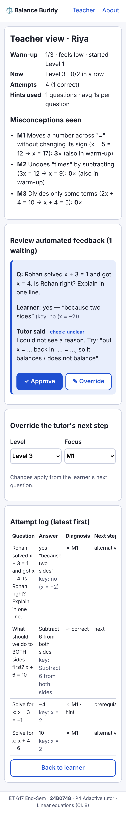 | 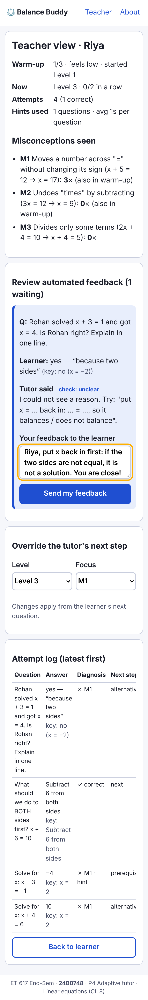 | 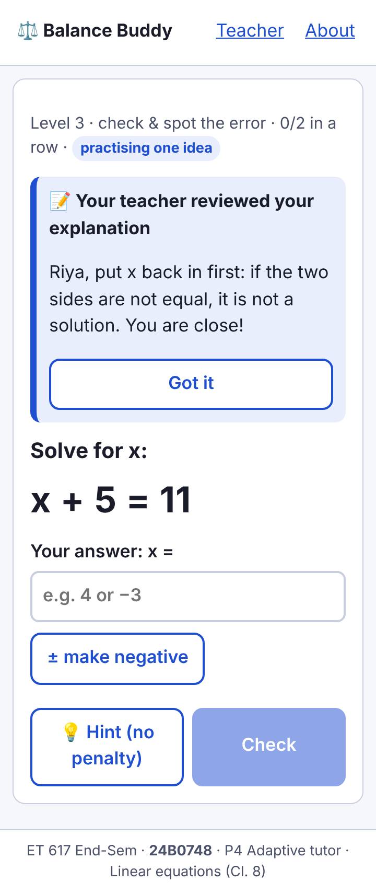 |

## D5 · Two contrasting learner scenarios
*Screenshots captured at 360 px with headless Chrome from the production build of the deployed commit.*

**(a) Learner who responds correctly.** Warm-up 3/3 and "Okay" → starts at Level 2 and skips the long explanation. Two correct answers in a row → "Next (a bit harder)" → Level 3. A *check-a-solution* task with a one-line explanation, which the explanation checker rates "strong".

| Practice | Correct → harder | Level 3 check | Explained |
|---|---|---|---|
| 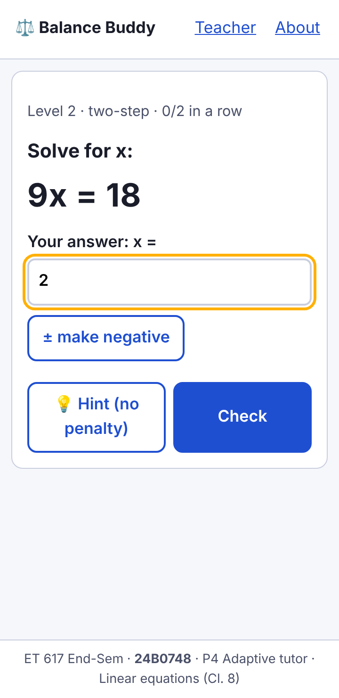 | 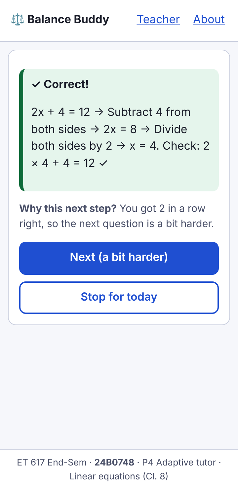 | 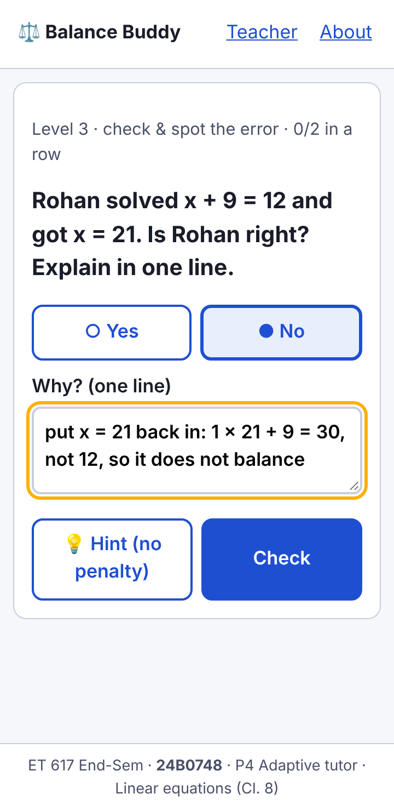 | 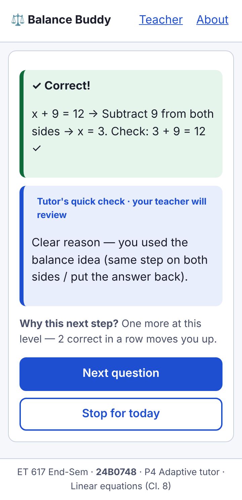 |

**(b) Learner showing misconception M1.** In the warm-up she picks x = 13 for x + 4 = 9 (M1) and says "😟 Worried" → Level 1, focus M1, Learn screen first. She answers 23 for x + 8 = 15 → **alternative explanation** with a tilted balance. On a similar item she uses a hint but still makes M1 → **prerequisite refresher** (opposite operations), where "Subtract 4" gets "Not yet" and "Divide by 4" passes → back at the easier level. At Level 3 she accepts a classmate's M1 solution → feedback is queued for the teacher.

| M1 answer | Alternative explanation | Same M1 again → refresher | Refresher |
|---|---|---|---|
| 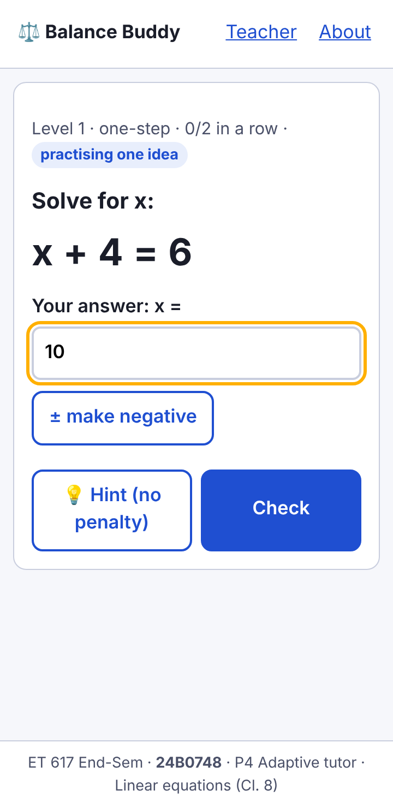 | 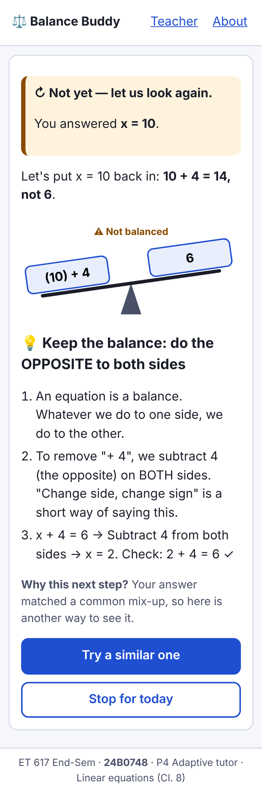 | 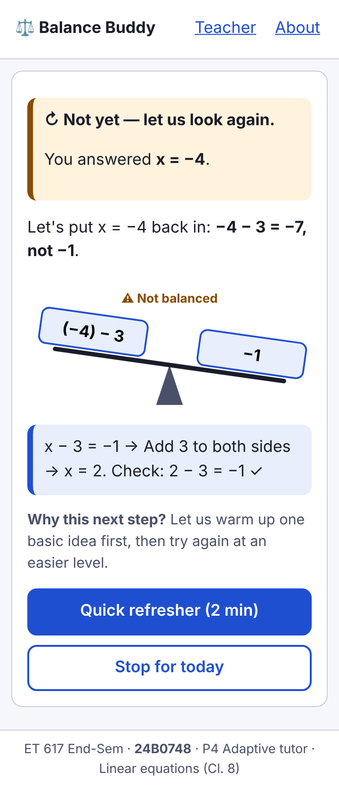 | 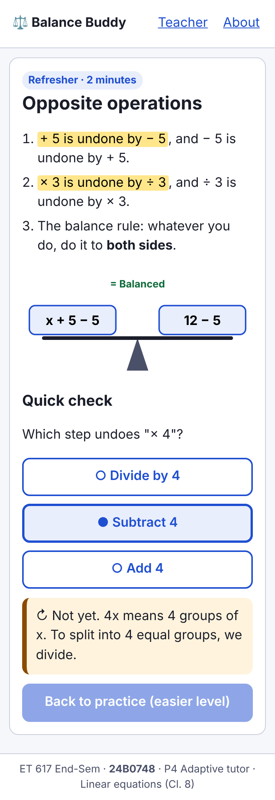 |

## D6 · AI functionality specification
Design choice: for an anxious learner, a wrong "correct answer" or confusing feedback costs more than it gains. The core is therefore a **deterministic, rule-based generator and diagnoser** that runs in the browser: answers are computed, never predicted. A **human (the teacher) checks** the only open-ended judgement, the explanations. There is no external AI service, so no API key, no network dependency and no hallucination risk. Each "AI" feature is specified below.

**1. Automatic question generation** (`src/lib/generator.js`)
- *What it does:* creates a new equation task matched to the learner's level and current misconception.
- *Input (actual call):* `generateQuestion(level = 2, focus = 'M1')`
- *Output (actual example):* `{ skill:'twoStep', expr:'3x + 4 = 19', answer:5, traps:{ M2:12 }, format:'numeric', steps:['3x + 4 = 19','Subtract 4 from both sides','3x = 15','Divide both sides by 3','x = 5'], check:'3 × 5 + 4 = 19 ✓' }`. With `focus` set, the generator retries (up to 10 times) until the question has a trap for that misconception, so it can actually show it.
- *Check before the learner sees it:* x is chosen first and c = a·x + b is computed from it, so every equation has an integer answer. Traps that are non-integers or equal to the answer are removed (`cleanTraps`).
- *Fallback:* if a focus trap cannot be generated, a normal question of the same skill is used.

**2. Misconception diagnosis** (`src/lib/diagnose.js → diagnose(q, response)`)
- *Input:* the question with its traps, and the learner's response (e.g. `{ value: '17' }` for x + 5 = 12).
- *Output:* `'correct' | 'M1' | 'M2' | 'M3' | 'unknown'`. Here: `'M1'` because the M1 trap for x + 5 = 12 is 17.
- *Check:* only exact matches to a computed trap are labelled as a misconception. Anything else is `'unknown'`, which leads to the safe move (prerequisite refresher), never to a wrong targeted explanation.
- *Fallback / wrong diagnosis:* the teacher sees every diagnosis in the attempt log and can override the focus and level.

**3. Adaptive decision rule** (`src/lib/tutor.js → decide(state, verdict, explained)`) — the P4 design challenge
| Condition | Next move |
|---|---|
| Correct (and explanation not "unclear" when one is asked) **2 in a row** | **Harder question** (level + 1) |
| Wrong, matches a known misconception, **first time** | **Alternative explanation** for that misconception + similar item (focus = that misconception) |
| Wrong and **unrecognised**, OR the **same misconception right after its alternative explanation** | **Prerequisite instruction** (refresher), then level − 1 |

Each move is shown to the learner with its reason ("Why this next step?"). All three outcomes appear in D5: a05 (harder), b05 (alternative), b07 (prerequisite).

**4. Explanation checker** (`checkExplanation(q, text)`)
- *Input (actual example):* text "put x = 9 back in: 2*9+3 = 21 not 11 so not balanced".
- *Rules:* looks for a balance/check idea (`both sides | balance | opposite | substitute | put … back | check`) AND an operation, the correct value, or a worked calculation (`9+3 = 21`).
- *Output:* `{ quality: 'strong' | 'partial' | 'unclear', feedback }`, here `'strong'`: "Clear reason — you used the balance idea…"
- *Check before the learner sees it:* the feedback is labelled "Tutor's quick check · your teacher will review". Every explanation enters the teacher's **review queue** (pending → approved / overridden). An "unclear" rating never marks the answer wrong; it only stops the streak from counting.
- *Fallback when wrong:* the teacher overrides it with their own words, and the learner sees the teacher's note on the next question.

**Possible LLM extension (not deployed):** the explanation checker could call an LLM with: *"You are a Class 8 maths teacher. Equation: {expr}. Correct x: {x}. Student's claim: {choice}. Student's reason: '{text}'. Reply in JSON {quality: strong|partial|unclear, misconception: M1|M2|M3|none, feedback: ≤ 25 simple words, no new method}."* Its output would be validated by JSON schema, would have to agree with the rule-based verdict, would go into the same teacher review queue, and would fall back to the rule-based feedback on timeout or disagreement.

## D7 · Pedagogical rationale
- **Diagnose, then target (P4).** Every generated item carries the answers its misconceptions would produce, so a wrong answer becomes evidence of a specific idea. This is error analysis, not right/wrong marking. The three-way decision rule moves the learner up (mastery: 2 in a row), sideways (an alternative representation of the same idea) or back (prerequisite), which keeps her in her zone of proximal development.
- **Balance as the central representation.** Concrete → pictorial → symbolic (Bruner). Instead of "wrong", the app substitutes the learner's own value and shows a **tilted balance** ("23 + 8 = 31, not 15"). This creates cognitive conflict from her own answer. It also models the check-by-substitution habit (Outcome 3).
- **Refutation text.** Each alternative explanation names the faulty rule ("Change side, change sign" is only shorthand for doing the opposite on both sides) and replaces it.
- **L5: anxious repeat learner.** No timer; "Not yet — let us look again" instead of red crosses; status always shown with an icon and words, never colour alone; hints carry no penalty; progress reported as skills and effort, not a percentage; warm-up items are "not marked"; a confidence question decides whether she sees the explanation first. Sessions are saved automatically, so she can stop any time ("Stop for today" / "Continue where I stopped").
- **C5: teacher-in-the-loop** shaped the AI design. The only judgement the rules cannot make reliably, whether a free-text reason is good, is routed to the teacher, who can approve it, rewrite it, or override the tutor's level and focus. The adaptivity is never a black box: the teacher sees each diagnosis and move.
- **Engagement (rubric P5):** conversational second person ("Let's put x back in"), one idea per screen, key phrases highlighted, worked steps joined by arrows.
- **Adaptivity (rubric P13):** profile (warm-up + confidence → start level and focus), performance (decision rule), interaction (hints on 2 questions in a row → balance helper shown by default; hints and time logged for the teacher).
- **Accessibility:** 48 px tap targets, labelled inputs, radio roles, focus moves to each new heading, skip link, high-contrast colours.

## D8 · Evaluation plan
| Outcome | Assessment | Log data | Success |
|---|---|---|---|
| 1 Solve | Pre/post test: 10 mixed one/two-step equations (paper or in-app Level 1–2) | verdict per item, level reached, attempts to level-up | ≥ 80 % on post-test and +30 percentage points over pre-test; reaches Level 3 within 2 sessions |
| 2 Explain | 3 "explain your step" items scored with a rubric (0 no reason / 1 names the operation / 2 "same opposite operation on both sides") | explanation checker quality, teacher approve/override rate | median rubric score ≥ 1.5; teacher overrides < 20 % (checker is trustworthy) |
| 3 Verify | 4 check/spot-the-error items with a mix of correct and misconception solutions | verdicts on check/spot formats, M1/M2 acceptances | ≥ 3/4 correct with substitution shown |
| Misconceptions | Same diagnostic distractors pre and post | counts of M1/M2/M3 per session | M1 and M2 frequency halves from session 1 to session 3 |
| Affect (L5) | 3-item confidence scale before and after (same 😟/😐/🙂 item) | hint use, "Stop for today" usage, return sessions | confidence rises by ≥ 1 step; learner returns for ≥ 3 sessions |

Small study: 10–15 repeat learners, 3 sessions over a week. Teacher interview on whether the review queue was useful and fast enough.

## AI-use log and reflection
**Log (in order):**
1. Claude (Anthropic), this chat, used for card selection, design, all code, testing, screenshots and this report draft. Share link: *(add link)*

**Reflection.** I used Claude as the developer: I gave the brief and made the decisions, and Claude wrote and tested the code in small commits. Decisions that were mine: the card (P4, L5, C5), switching the topic from Integers (T1) to Linear equations (T3) at 18:17 before the first deploy, and no paid AI API. The AI caught a card mismatch I made (I first chose the pendulum topic, which belongs to P5, not P4). Testing caught real bugs that I checked: the balance tilted the wrong way, and the alternative explanation quoted fixed numbers instead of the question's own. I avoided an LLM for feedback the learner sees directly because an anxious learner should not get confidently wrong feedback. Generation is deterministic, and the one open-ended judgement goes to the teacher. Limitations: the explanation checker is keyword-based, so it can rate a vague answer "partial", which is why every explanation goes through the teacher queue. Teacher and learner share one device's storage; a real deployment would need a small backend to sync them.
